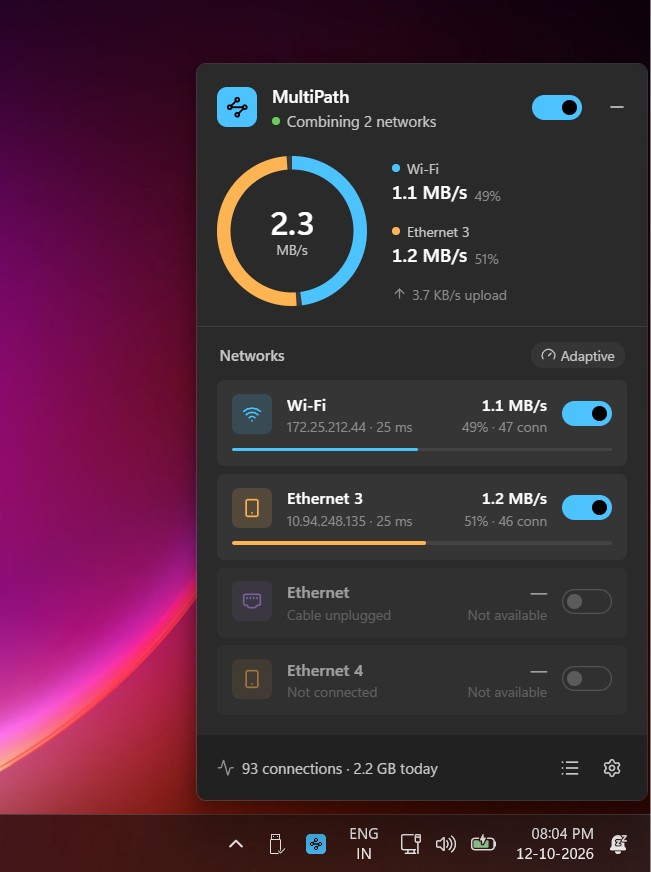
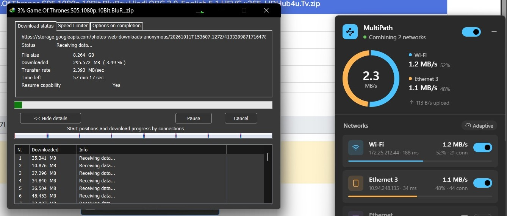

<div align="center">


# MultiPath

**Use Wi-Fi, Ethernet and a USB-tethered phone at the same time, for the whole PC.**

A small tray app for **Windows and Linux**, built with **Tauri v2 and Rust**. Everything runs on your PC: no server,
no relay, no account.

<a href="https://github.com/uditya-kumar/MultiPath/releases/latest"></a>


[](LICENSE)

</div>


## Screenshots

<p align="center">
  
  <br />
  <em>The tray popup, combining Wi-Fi and a USB-tethered phone</em>
</p>

<p align="center">
  
  <br />
  <em>A download manager with several connections: about half go over Wi-Fi and half over the phone</em>
</p>

## What it does

- Spreads your PC's connections across all your networks, so they all work at once.
- Two 10 Mbps networks give you about **20 Mbps** for anything that opens several connections.
- Lives in the tray as a small popup: turn it on, switch networks on or off, see each network's speed.

## What gets faster

MultiPath balances **connections**. One connection always stays on one network, because splitting it would need a
server on the internet.

| Gets faster ✅ | Doesn't get faster ❌ |
|---|---|
| Speed tests (fast.com, Speedtest) | A single download over one connection |
| YouTube and other streaming sites (video and audio load in chunks) | One video call or game session |
| Download managers, Steam, torrents | |
| Browsers loading many things at once | |
| Several downloads at the same time | |

## Tech stack

| Part | Technology |
|---|---|
| App shell |  [Tauri v2](https://tauri.app/) |
| Backend |  Rust |
| Async runtime |  [Tokio](https://tokio.rs/) |
| Traffic capture |  [Wintun](https://www.wintun.net/) adapter on Windows, `/dev/net/tun` on Linux, via the [`tun`](https://crates.io/crates/tun) crate |
| TCP/IP stack |  [`ipstack`](https://crates.io/crates/ipstack) (userspace) |
| Packets, sockets |  [`etherparse`](https://crates.io/crates/etherparse), [`socket2`](https://crates.io/crates/socket2), [`netdev`](https://crates.io/crates/netdev) |
| System APIs |  [`windows-sys`](https://crates.io/crates/windows-sys), and [`libc`](https://crates.io/crates/libc) with netlink on Linux (routes, sockets, elevation) |
| Frontend |  React 19 |
| Language |  TypeScript |
| Build tool |  Vite |
| Icons |  [Lucide](https://lucide.dev/) |
| Tests |  [Vitest](https://vitest.dev/), `cargo test` |
| Packaging |  NSIS,  `.deb` and AppImage (through Tauri) |

## How it works

Think of your networks as checkout counters, and each connection as a customer. MultiPath is the manager at the door.

1. **Catch the traffic.** MultiPath adds a virtual network adapter called `MultiPath`. All of the PC's traffic goes
   through it.
2. **Pick a network.** For each new connection, MultiPath works out which network would give it the most speed:

   > **network speed ÷ (connections downloading on it + 1)**

   The network with the biggest number gets the connection. Idle connections don't count.
3. **Send it out.** The connection is made again from that network, pinned to its adapter.
4. **Keep checking.** Every 5 seconds, each network is checked for internet. A network that fails twice in a row gets
   no new connections until it works again.

**Example:** two 10 Mbps networks, and fast.com opens 4 connections:

| Connection | Wi-Fi score | Phone score | Goes to |
|---|---|---|---|
| 1st | 10 ÷ 1 = **10** | 10 ÷ 1 = **10** | Wi-Fi |
| 2nd | 10 ÷ 2 = 5 | 10 ÷ 1 = **10** | Phone |
| 3rd | 10 ÷ 2 = **5** | 10 ÷ 2 = **5** | Wi-Fi |
| 4th | 10 ÷ 3 = 3.3 | 10 ÷ 2 = **5** | Phone |

Both networks end up with half the connections and run flat out: **10 + 10 = 20 Mbps**. A faster network gets
proportionally more.

### Good to know

- **Switching a network off** closes its connections. Apps reconnect through the other networks.
- **Switching it back on** only gets *new* connections. Downloads already running stay where they are until they finish
  or reconnect.
- **IPv6** is only used on networks where it actually works. Otherwise apps are told to use IPv4 straight away.
- **DNS** goes to 8.8.8.8, then 1.1.1.1 (some ISPs block 1.1.1.1). You can change this in Settings.
- **Turning MultiPath off** removes everything it added, so your system goes back to normal.

## Install

Everything is on the [latest release](https://github.com/uditya-kumar/MultiPath/releases/latest) page.

### Windows

1. Run `MultiPath_<version>_x64-setup.exe`.
2. Click the MultiPath icon in the tray and turn it on. Windows asks for administrator permission once.

### Linux

**Debian, Ubuntu, Kali and anything else that uses `.deb`** — the package gives MultiPath the two network
permissions it needs, so turning it on never asks for a password:

```sh
sudo apt install ./MultiPath_<version>_amd64.deb
```

**Anything else** — the AppImage. An AppImage can't hold those permissions, so it needs `sudo`:

```sh
chmod +x MultiPath_<version>_amd64.AppImage
sudo ./MultiPath_<version>_amd64.AppImage
```

| Requirement | Why |
|---|---|
| Windows 10 or 11 (64-bit), or a 64-bit Linux desktop | Uses each system's networking APIs |
| Administrator rights, or `CAP_NET_ADMIN` on Linux | Needed to add the adapter and routes |
| Two or more working networks | Otherwise there's nothing to combine |

*Start with Windows* / *Start on login* (in Settings) puts MultiPath in the tray when you sign in, with no
permission prompt.

**On Linux,** the tray icon needs a panel that shows app indicators — GNOME needs the *AppIndicator* extension. Only
`systemd-resolved` systems get MultiPath's own DNS settings; elsewhere the system resolver is used, which works too.

## Getting started (developers)

**You need:**

- [Rust](https://rustup.rs/) (stable)
- [Node.js](https://nodejs.org/) 20 or newer
- [Tauri prerequisites](https://tauri.app/start/prerequisites/) — WebView2 and MSVC build tools on Windows;
  `libwebkit2gtk-4.1-dev`, `libgtk-3-dev` and `libayatana-appindicator3-dev` on Linux

**Run it:**

```sh
git clone https://github.com/uditya-kumar/MultiPath.git
cd MultiPath
npm install
npm run tauri dev       # opens the app; run it as administrator or root, or accept the permission prompt
```

**Build the packages:**

```sh
npm run tauri build     # Windows: bundle/nsis/ · Linux: bundle/deb/ and bundle/appimage/
```

**Check before committing:**

```sh
npm run lint && npm test && npm run build
cd src-tauri && cargo fmt --check && cargo clippy --all-targets -- -D warnings && cargo test
```

**Project layout:**

| Folder | What's inside |
|---|---|
| `src/` | The popup (React): `api/` talks to Rust, `components/`, `views/`, `lib/`, `styles/` |
| `src-tauri/src/app/` | Tauri glue: settings, status, commands, tray and popup |
| `src-tauri/src/engine/` | Traffic capture and relaying (TCP, UDP, ICMP) |
| `src-tauri/src/net/` | Networks, health checks, the balancer |
| `src-tauri/src/sys/` | System API wrappers: `windows/` and `linux/`, behind one API |

## Limits

- One connection always uses one network.
- A full-tunnel VPN takes over the routes while it's connected.
- Some sites sign you out if your requests come from different addresses. Turn on *Keep sites on one network* for those.

## License

MultiPath is released under the [MIT License](LICENSE).

Wintun is © WireGuard LLC. Its license is in `src-tauri/resources/wintun-LICENSE.txt`.
